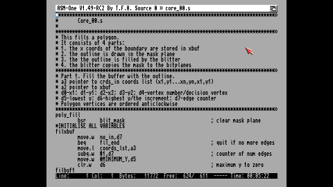
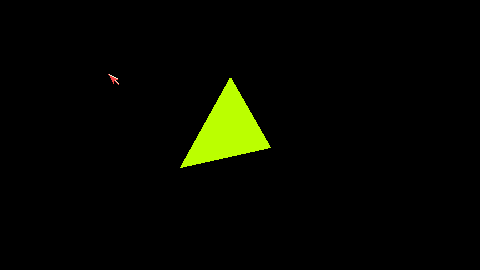
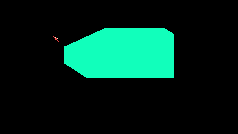
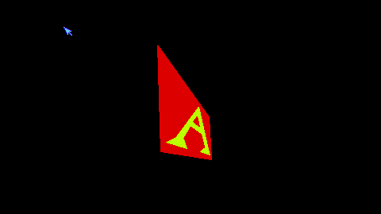
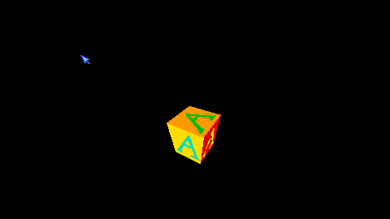
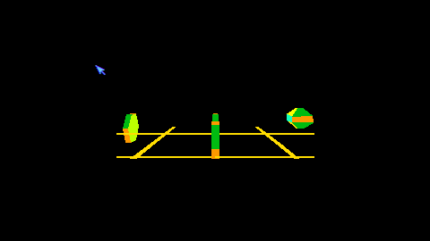

# amiga-realtime3d

The 3D engine from the book "Amiga Real-Time 3D Graphics".



## Prerequisites

To run the demos and build them with ASM-One on the emulated Amiga, you need:

- [Amiberry](https://github.com/BlitterStudio/amiberry) Amiga emulator
- Amiga Kickstart ROM (support [Amiga Forever](https://www.amigaforever.com/))

To cross-compile the demos, you also need:

- [vasm](http://sun.hasenbraten.de/vasm/index.php?view=main) assembler
- [Meson](https://mesonbuild.com/) and [Ninja](https://ninja-build.org/) build tools

### Install Amiberry

#### Ubuntu

```
$ sudo add-apt-repository ppa:midwan-a/amiberry
$ sudo apt install amiberry
```

#### macOS

```
$ brew install --cask amiberry
```

To run `amiberry` from the command line, add an alias to your shell configuration (for example `~/.zshrc`):

```sh
alias amiberry='/Applications/Amiberry.app/Contents/MacOS/Amiberry'
```

### Install Kickstart ROM

The Kickstart ROM is copyrighted and not included in this repository. You need the Kickstart 3.1 (40.68) ROM for the
A1200.

Copy the ROM file `Kickstart v3.1 rev 40.68 (1993)(Commodore)(A1200)[!].rom` to the Amiberry ROM directory:
```
$ mkdir -p ~/Documents/Amiberry/ROMs
$ cp "Kickstart v3.1 rev 40.68 (1993)(Commodore)(A1200)[!].rom" ~/Documents/Amiberry/ROMs/
```

### Amiga folders

The repository contains everything the emulated Amiga needs, apart from the Kickstart ROM:

| Folder         | Amiga volume | Contents |
|----------------|--------------|----------|
| `Amiga/System` | `System:`    | Workbench 3.1 |
| `Amiga/Work`   | `Work:`      | Applications |
| `Amiga/CLI`    | `CLI:`       | Only mounted to boot into a Shell instead of Workbench (see below) |
| `.`            | `Sources:`   | This repository: the demo sources, includes and build output |

### Configure Amiberry

Add the following aliases to your shell configuration. Run them from the root of this repository, since they mount the folders relative to `$PWD`.

```sh
alias a1200='amiberry --model A1200 \
    -s use_gui=no \
    -s fastmem_size=8 \
    -s amiberry.gfx_auto_crop=true \
    -s kickstart_rom_file="$HOME/Documents/Amiberry/ROMs/Kickstart v3.1 rev 40.68 (1993)(Commodore)(A1200)[!].rom" \
    -s filesystem2=rw,DH0:System:$PWD/Amiga/System,0 \
    -s filesystem2=rw,DH1:Work:$PWD/Amiga/Work,-128 \
    -s filesystem2=rw,DH2:Sources:$PWD,-128'

alias a1200-cli='amiberry --model A1200 \
    -s use_gui=no \
    -s fastmem_size=8 \
    -s amiberry.gfx_auto_crop=true \
    -s kickstart_rom_file="$HOME/Documents/Amiberry/ROMs/Kickstart v3.1 rev 40.68 (1993)(Commodore)(A1200)[!].rom" \
    -s filesystem2=rw,DH0:System:$PWD/Amiga/System,0 \
    -s filesystem2=rw,DH1:Work:$PWD/Amiga/Work,-128 \
    -s filesystem2=rw,DH2:Sources:$PWD,-128 \
    -s filesystem2=ro,DH3:CLI:$PWD/Amiga/CLI,-128'
```

- `a1200` boots into Workbench.
- `a1200-cli` boots into a Shell.

## Native compilation

### Build demos with ASM-One

1. Start Amiberry
   ```
   $ a1200
   ```

1. Start ASM-One

   Open the `Work` disk and execute `ASM-One_V1.48`

   Enter `c` and `200` to allocate 200 KB of chip memory

1. Open demo source file

   Enter `r sources:src/Program_01.s` to open demo source file

1. Build demo source file

   Enter `a` to assemble demo

1. Run demo

   Enter `j` to run demo

## Cross-compilation

### Install vasm

1. Clone vasm
   ```
   $ git clone https://github.com/StarWolf3000/vasm-mirror.git
   $ cd vasm-mirror
   ```

1. Build vasm
   ```
   $ make CPU=m68k SYNTAX=mot
   ```
   The build will generate a binary `vasmm68k_mot`. Put this binary in a user-reachable location (for example `~/bin/`).

### Install Meson and Ninja

#### Ubuntu

```
$ sudo apt install meson ninja-build
```

#### macOS

```
$ brew install meson ninja
```

### Build demos with vasm

To build the Amiga demo programs, run:
```
$ meson setup build
$ meson compile -C build
```
The demo programs are written to the `build` directory.

### Run demos

1. Start Amiberry in a Shell
   ```
   $ a1200-cli
   ```

1. Run demo
   ```
   1> Sources:build/Program_01
   ```

## License

Licensed under Creative Commons Attribution Share Alike 4.0 International. See [LICENSE](LICENSE) for more information.

## Authors

* Johan Gardhage
* General ideas and code from Andrew Tyler's book [Amiga Real-Time 3D Graphics](https://www.amazon.co.uk/Amiga-Real-time-3D-Graphics-Virtual/dp/1850582750)
* Original source code and a scanned pdf of the book can be found [here](https://gitlab.com/amigasourcecodepreservation/amiga-real-time-3d-graphics)

## Screenshots







